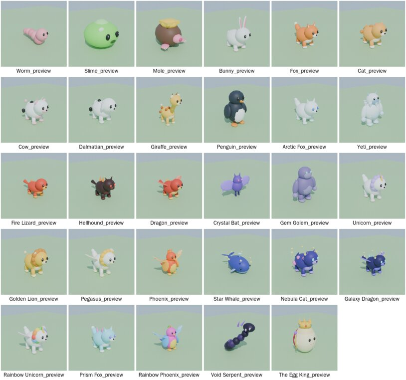
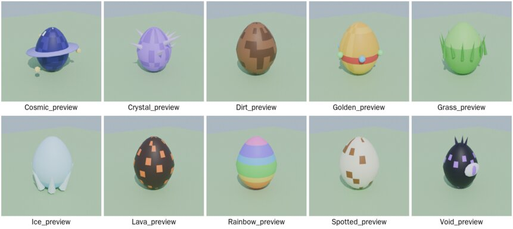

# 🥚 Steal an Egg

A Roblox game that combines two viral hits:

- **Steal a Brainrot**: buy items off a conveyor, they earn cash in your base, other players can steal them, you bonk thieves and lock your base.
- **Grow a Garden / pet sims**: eggs incubate and hatch into pets with rarities and **mutations** (Golden / Diamond / Rainbow / Galaxy), plus server-wide **weather events** and **Server Luck**.

## Core loop

1. **Buy eggs** from the conveyor in the middle of the map (cash). Rare eggs get announced to the whole server.
2. Eggs **incubate** on your pedestals and earn $/sec while they wait.
3. They **hatch** into a random pet (odds shown above every egg) with a chance of a mutation multiplier. Pets earn 3x–40x+ more.
4. Cash builds up on each pedestal. **Walk over the green pad** to collect it (or buy Auto Collect).
5. **Steal**: hold E on someone else's pedestal and run the loot back to your base (you move slower while carrying).
6. **Defend**: everyone has a **Bonk Bat**. Hit a thief and the loot goes straight back. Step on the **LOCK pad** to put up a 60 s laser door.
7. **Rebirth** for +50% income and +1 slot each time.
8. Retention hooks: free egg gift every 10 min, offline earnings (50%, up to 8 h), random events every 8 min.

## Running it

The project uses [Rojo](https://rojo.space).

```bash
cd StealAnEgg
```

```bash
rojo serve
```

Then in Roblox Studio, open an **empty Baseplate**, connect with the Rojo plugin, and press Play. The whole map (ground, conveyor, 8 bases) is built by code, so there's nothing to place by hand. Delete the default `Baseplate` part and `SpawnLocation` (everyone spawns at their own base).

To test saving in Studio, turn on **Game Settings → Security → Enable Studio Access to API Services**.

For a 2-player test of stealing: **Test → Clients and Servers → 2 Players**.

## Adding real models (found with ForgeGUI)

The game works with built-in procedural eggs and pets. To swap in real models, put them in
`ServerStorage/Models/Eggs` (named by egg **Id**, e.g. `Lava`) or `ServerStorage/Models/Pets`
(named by **pet name**, e.g. `Penguin`). They get auto-scaled, and any scripts inside are deleted for safety.

### Custom Blender models (included)

`models/` has an original low-poly model for **every egg (10) and every pet (29)**, made in Blender by
`blender/make_models.py`. Each one is a single mesh with a tiny palette texture, so it's one MeshPart in
Roblox, between 400 and 3,400 triangles.




To import them:
1. In Studio, use **File → Import 3D** (or Avatar → Import 3D) and pick e.g. `models/Pets/Fox.glb` (`.fbx` works too).
2. Import it as a **Model**, rename it exactly like the pet (`Fox`), and drag it into `ServerStorage/Models/Pets`.
   Eggs go into `ServerStorage/Models/Eggs`, named by egg Id (`Lava`, `Void`, ...).
3. Done. The game scales it, positions it, and adds mutation sparkles automatically.

The models face −Z, the same as the built-in ones. If one comes in turned around, rotate it 180° before saving it in ServerStorage.

To change or add models, edit the `PETS` table / `make_eggs()` in the script, then rebuild:

```bash
blender -b -P blender/make_models.py -- models
```

Add `--only Fox Dragon` to rebuild just those, or `--no-render` to skip the previews.

### Toolbox alternatives

Toolbox picks from ForgeGUI search (insert by ID in Studio, then rename):

| Use as | Toolbox model | Asset ID |
|---|---|---|
| `Penguin` (Ice Egg) | Penguin, by **Roblox** | 170822767 |
| `Cat` (Grass Egg) | House Cat | 3676024481 |
| `Fox` (Grass Egg) | Red Fox (Low Poly) | 2374000270 |
| `Arctic Fox` (Ice Egg) | Arctic Fox | 2084839371 |
| `Bunny` (Grass Egg) | Bunny Toy | 6132351260 |
| `Slime` (Dirt Egg) | slime | 4826291775 |
| `Dragon` (Lava Egg) | Dragon Pet | 12473517134 |
| `Unicorn` (Crystal Egg) | Flying Unicorn | 4734361534 |
| `Rainbow Unicorn` | Cotton Candy Winged Unicorn | 5621152316 |
| Egg template | Dragon Egg (Eggventure 2016) | 380074338 |
| Conveyor look | Conveyor Belt (animated) | 7063606146 |

⚠️ **Don't** use the Toolbox rips of *Pet Simulator X* or *Adopt Me* pets: they're other games' IP and can get your game taken down. Before publishing, check every free model for hidden scripts. The loader deletes scripts, but look anyway.

For pets with no good free model (Phoenix, Galaxy Dragon, The Egg King, ...), generate them with ForgeGUI's `generation_model_3d`. It can publish straight to Roblox as a Model asset. ForgeGUI can also make the game icon, thumbnails, and gamepass icons (`generation_image` with `type: icon_gfx`, `thumbnail`, `roblox_gamepass`).

## Making Robux

Create these in **Creator Hub → your experience → Monetization**, then paste the IDs into `src/shared/Config.lua` (`Config.GamePasses` / `Config.Products`). Anything left at `0` shows as "Soon" in the shop.

| Game passes | Suggested price |
|---|---|
| VIP (1.5x income) | 199 |
| 2x Cash | 399 |
| +3 Egg Slots | 249 |
| Fast Hatch | 149 |
| Auto Collect | 99 |

| Developer products | Suggested price |
|---|---|
| Cash packs (10 min / 1 h / 6 h of income) | 25 / 99 / 399 |
| **Server Luck** (Lucky Hour for the whole server, buyer's name announced) | 149 |
| Base Shield (10 min steal protection) | 49 |
| Hatch All Eggs Now | 39 |

Purchases use `ProcessReceipt` with duplicate-receipt protection.

**Policy:** every egg shows its pet odds, and none of the Robux products sells a random item directly. Keep it that way: Roblox requires odds to be shown before any paid random item.

### Growth tips

- Your thumbnail and icon matter more than anything else. Make them bright and show a giant glowing egg being stolen.
- Run timed updates (new egg plus a new event) every weekend. That's how both games you're copying grew.
- Tune `Config.lua` for a fast first session: the first hatch in under a minute, and the first steal in the first 5 minutes.

## Files

```
StealAnEgg/
├── default.project.json        Rojo project
└── src/
    ├── shared/Config.lua       ← all balance, odds, Robux IDs
    ├── shared/Util.lua
    ├── server/Main.server.lua  bootstrap, join/leave, rebirth, gifts
    ├── server/Services/
    │   ├── Data.lua            DataStore save/load/autosave
    │   ├── Plots.lua           map + bases, lock pad, laser door
    │   ├── Pedestals.lua       placing, hatching, income, collect, sell
    │   ├── Conveyor.lua        egg spawning + buying
    │   ├── Steal.lua           stealing + carrying + delivery
    │   ├── Bat.lua             Bonk Bat
    │   ├── Events.lua          Lucky Hour / Golden Rush / Cash Frenzy
    │   ├── Monetization.lua    game passes + dev products
    │   └── Visuals.lua         egg/pet models, mutations, effects
    └── client/HUD.client.lua   cash, shop, rebirth, gifts, toasts, events
```
